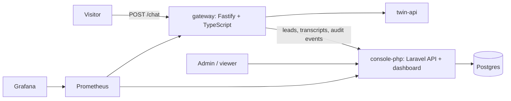

# AI Digital Twin: security evaluation

A tool-using, document-grounded chat agent (the "digital twin") plus a reproducible harness that measures how well
layered defenses (D0 to D3, modules M1 to M3) resist prompt injection, indirect injection and tool misuse.

- `twin/` the agent (Gradio chat, OpenAI-compatible API, two tools, mock or real backend)
- `eval/` cases (`eval/cases`), harness (`eval/harness`), model registry (`eval/models.yaml`), results (`eval/results`)
- `docs/` threat model and protocol, implementation plan, architecture findings, model licence notes
- `tests/` pytest suite including a D0-equivalence test against a frozen copy of the baseline loop

Status: baseline (D0) refactor and evaluation harness done; defenses (D1 to D3), new tools and the adaptive
attacker are planned in `docs/IMPLEMENTATION_PLAN.md`. Results under `eval/results/stub-dev` come from stub models
and are not findings about any real model.

## Run
```
pip install -r requirements-dev.txt openai pypdf requests python-dotenv
python -m pytest -q tests
PYTHONPATH=. python -m eval.harness.run --models stub-gullible stub-refuser --split dev --k 1 --dry-run
```
Live twin: copy your own `summary.txt` and `linkedin.pdf` into `twin/` (they are git-ignored), set `OPENAI_API_KEY`
(and Pushover variables if you want notifications), then `cd twin && python app.py`.

## Ethics
Attacks run only against this repository's own twin, through a mock tool sink, with a fictional persona.
`attacker.example` style hosts are placeholders and are never contacted. No licence has been chosen yet.

## Admin console extension
An admin console around the twin: a Node gateway for chat, a Laravel API and dashboard for leads, conversation logs, evaluation runs and an audit log, Postgres, and optional Prometheus and Grafana. Nothing in `twin/` or `eval/` was changed. Plan: `docs/PLAN.md`. API contract: `docs/openapi.yaml`. Design choices: `docs/DECISIONS.md`.



Run it (Docker required):
```
./infra/gen-env.sh                        # writes .env with random secrets (git-ignored)
docker compose up --build                 # dashboard :8000, gateway :8080 (127.0.0.1 only)
docker compose run --rm app php artisan db:seed   # prints generated admin and viewer passwords
./infra/smoke.sh                          # end-to-end check
docker compose --profile monitoring up    # adds Prometheus :9090 and Grafana :3000
docker compose --profile reporting run --rm eval-reporter python -m reporter sync --results /results --api http://web   # load eval/results into the console (idempotent)
```

| Component | Tech | Tests |
|---|---|---|
| `console-php/` | Laravel 13, Sanctum, Blade, Postgres | 43 PHPUnit feature tests |
| `gateway/` | Fastify, TypeScript | 27 Vitest tests |
| `twin/server.py` | FastAPI wrapper over the unchanged `run_chat` loop | 16 pytest tests (in the 90-test suite) |
| `eval-reporter/` | Python, standard library only | 17 pytest tests |
| `infra/` | Compose, Prometheus, Grafana, Terraform (AWS) | `infra/smoke.sh`, `terraform validate`, Trivy in CI |

### Honest limitations
- **The default `twin-api` is still a stub** (`infra/twin-stub`: canned replies, no model) so CI and a fresh clone work without an LLM. The real agent is `twin/server.py`; run it with `TWIN_API_URL=http://twin-agent:7861 docker compose --profile agent up --build` after copying your own `twin/summary.txt` and `twin/linkedin.pdf` (they are mounted, never baked into the image) and setting a model. It has been tested with a scripted model and as a container, not against a live LLM in this stack.
- **The agent is not streaming.** With `Accept: text/event-stream` the gateway replays the finished reply in chunks.
- **The agent has no human-approval step.** The console's approve/reject on leads is a new console feature, logged as an audit event. The audit log records decisions that exist (policy gate, output guard, tool calls) when the twin reports them.
- **Terraform has been validated but never applied.** No cloud account was used. There is no TLS termination in the stack yet.
- **Not built:** MongoDB conversation logs (stored as JSON in Postgres instead) and the security-test suite.
- **Evaluation runs in the console** summarise attack trials only (attack success rate, passed/total, latency, cost, failing cases). Benign over-refusal is not included. Existing `eval/results/*/table_asr.csv` files can be stale (the qwen3 D0 one predates a larger run); the reporter reads `runs.jsonl`, and its counts match `eval.harness.stats`.
- Trivy findings are point-in-time; a new CVE in a base image can fail the `images` workflow later.

### Who built what
| Part | Owner |
|---|---|
| Laravel API and dashboard, Node gateway, agent HTTP API (`twin/server.py`), eval-reporter, Docker Compose, CI workflows, observability, Terraform | Guru |
| Agent (`twin/`), evaluation harness (`eval/`), defenses, tests | existing project |
