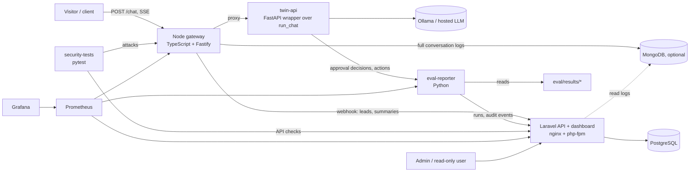

# Plan: Admin console around the AI digital twin

## Context
The repo has a Python "digital twin" agent (`twin/`) and a security-evaluation harness (`eval/`). We add an admin console around it (leads, conversation logs, evaluation runs) so two people can each show backend/DevOps work in interviews. Nothing existing is rewritten. Status: approved by both project owners.

## 1. What is in the repo today (surveyed, read-only)
- **Origin mismatch:** local `origin` is `ed-donner/agents` (upstream course repo, 3,115 commits, 21 are ours). You said the linked Thanushreesridhara repo is the real home. Before any push: add it as a remote, compare histories, never push to ed-donner. *Decision needed, see section 9.*
- **README.md** is 217 bytes, one heading, and says nothing about the agent or security evaluation. "Don't change existing claims" is trivially met; we append sections. The real evaluation description lives in `eval/README.md` and `docs/` and stays untouched.
- **Agent (`twin/`)**: Python 3.12, Gradio chat (`twin/app.py`, port 7860), reusable loop `twin/agent.py::run_chat`. OpenAI-compatible client (Ollama qwen3:8b / llama3.1:8b, hosted gpt-5-nano). Tools: `record_user_details` (lead capture) and `record_unknown_question`, sent to Pushover only (`twin/backends.py`; `MockBackend` for tests). **No HTTP chat API, no streaming, no stored leads, no human-approval step** (`confirm_leads: false` is only a flag). `RunLogger` writes JSONL per request when `TWIN_LOG_PATH` is set.
- **Defenses**: D0 (frozen baseline), D1 prompt hardening, D2 policy gate, D3 output guard, M1 heuristic detector. Selected by `TWIN_DEFENSE`.
- **Evaluation (`eval/`)**: 115 attack and 65 benign cases, six oracle types, an LLM judge (unvalidated until audit labels exist), Wilson/McNemar/bootstrap stats, 8 result folders. **No RAGAS.** Run records: `runs.jsonl` (key, case_id, class, model, defense, success, refused, latency_s, tokens, cost_usd...), `requests.jsonl`, `manifest.json`, `table_asr.{csv,md}` (missing for the two `defenses-dev-*` folders; reporter can generate them via `eval.harness.report`).
- **Tests/CI**: 66 pytest functions in `tests/`; `.github/workflows/ci.yml` runs ruff, pytest, D0 smoke, stub harness run. Not re-run by the survey (pytest missing from `.venv`); we install `requirements-dev.txt` and run them as the baseline in M0.
- **Docker**: only `Dockerfile.test` / `docker-compose.test.yml` (placeholder agent+sink, locked-down network). No production image. **The real agent can run in Docker** (pure Python), so no stub is needed.
- **Secrets**: `.env` is untracked and was never committed (holds 3 API keys; rotate if ever shared). Tracked files contain only fake test keys in `tests/`. Only the 21 local commits were scanned; the 3,000+ upstream commits were not, and gitleaks has not been run. M0 runs gitleaks and reports.
- **Personal data**: `twin/summary.txt` (tracked) holds real personal details; `eval/manual/persona/` is ignored. You chose "keep as is"; we only document this in docs/SECURITY.md and keep `.env`/persona folders out of Docker contexts via `.dockerignore`.
- `docs/ARCHITECTURE.md` was updated on 2026-11-26: D1-D3/M1 are implemented, not yet analysed.

## 2. Architecture

Contract between everything: `docs/openapi.yaml` (written first, M1).

**Framework choice: Laravel** (not Symfony). Gentlest curve for someone new to PHP: conventions, Eloquent, built-in auth (Sanctum), validation, migrations/seeders, rate limiting, CSRF, and Pest/PHPUnit are all included. Framework-specific parts are explained in docs/DECISIONS.md. Gateway: **Fastify** (built-in schema validation, rate-limit plugin, fast, Vitest fits).

**Agent wrapper (assumption, you approved the option):** one small new file `twin/server.py` (FastAPI) that calls `run_chat` unchanged, exposes `POST /chat` and `/health`. The agent is non-streaming, so "streaming" means the wrapper sends the finished reply as SSE chunks. The README will say exactly that. Owner: Thanushree. Existing `twin/` code is not modified; D0 equivalence test must still pass.

**Human approval (honest scope):** the agent has none. The audit log will record the *decisions that exist* (D2 policy gate allow/deny, D3 output guard, tool calls). Admin approve/reject of a lead in the PHP dashboard is a new feature and is logged as an audit event. Label it as that, not as agent-side human-in-the-loop.

## 3. Target folder structure
Existing folders unchanged. New top-level folders only:
```
console-php/        Laravel app, tests (Pest), Dockerfile, nginx conf        [Guru]
gateway/            Fastify TS, Vitest, Dockerfile                           [Guru]
infra/              compose, terraform/, monitoring/ (prometheus, grafana)   [Guru]
eval-reporter/      FastAPI+prom client, audit log, pytest, Dockerfile       [Thanushree]
security-tests/     pytest red-team and API checks                           [Thanushree]
docs/               PLAN, DECISIONS, SECURITY, INTERVIEW_NOTES, openapi.yaml [shared]
```
Plus root additions: `docker-compose.yml`, `.env.example`, `CONTRIBUTING.md`, `.dockerignore`, workflow files `.github/workflows/{console,gateway,python-services,security,images}.yml` (the existing `ci.yml` is left as is). `twin/server.py` and `twin/Dockerfile` are the only additions inside existing folders (Thanushree).

## 4. Milestones (estimates are part-time person-days)
Branches `feat/<area>`; each person commits with their own `git config user.name/email` (checked at the start of every milestone).

| # | Milestone | Owner | Est | Starts |
|---|---|---|---|---|
| M0 | Baseline: run existing tests/eval (`pytest tests`), gitleaks over full history, secrets report, `.gitignore`/`.dockerignore`, CONTRIBUTING.md | Guru (tests, CI check) + Thanushree (secrets report) | 1 | now |
| M1 | `docs/openapi.yaml` + mock server (Prism or tiny stub) + docs/PLAN.md | Guru drafts, both review | 1 | now |
| T1 | `twin/server.py` + `twin/Dockerfile` + pytest (mock backend) | Thanushree | 2 | now |
| T2 | eval-reporter: reads `eval/results/*`, computes pass rate/latency/failed checks, posts to API (against mock), `table_asr` generation | Thanushree | 3 | after M1 contract, runs against mock |
| T3 | Audit log: structured JSONL events (tool calls, D2/D3 decisions, admin approvals), forward to API, pytest | Thanushree | 2 | after M1 |
| T4 | Prometheus metrics in eval-reporter (`/metrics`) | Thanushree | 1 | after T2 |
| T5 | security-tests: prompt injection/jailbreak cases through the gateway (reuse attack cases from `eval/cases/attack_cases.jsonl`), safe-behaviour assertions, API checks (auth bypass, rate limit, validation) | Thanushree | 4 | tests run against mocks first, real stack later |
| T6 | docs/SECURITY.md: OWASP LLM Top 10 + Agentic mapping + Top 10 checklist, findings filed as issues | Thanushree | 2 | continuous |
| G1 | Laravel scaffold, migrations (leads, conversations, evaluation_runs, audit_events), seeders, Sanctum auth, roles | Guru | 3 | after M1 |
| G2 | REST endpoints per OpenAPI + validation + Pest feature/unit tests | Guru | 4 | after G1 |
| G3 | Admin dashboard (Blade, server-rendered, simple tables), CSRF, XSS escaping, security headers, rate limiting | Guru | 3 | after G2 |
| G4 | Node gateway: `/chat` proxy w/ streaming, API-key check, rate limit, request log, `/health`, lead webhook to PHP; Vitest | Guru | 4 | after M1 |
| G5 | MongoDB conversation logs (**optional**) | Guru | 2 | after G4 |
| G6 | Docker Compose full stack (php, nginx, node, agent, eval-reporter, postgres, mongo, prometheus, grafana), one command | Guru | 2 | after T1, G2, G4 |
| G7 | CI: lint+tests per service, build, Trivy, GHCR push, deploy stub, security-tests against Compose | Guru, Thanushree reviews T-parts | 3 | after G6 |
| G8 | Observability: `/metrics` for API and gateway, Grafana dashboard JSON (Thanushree reviews) | Guru | 2 | after G4/G6 |
| G9 | Terraform: one VM + network + secrets, validated and documented | Guru | 2 | last |
| D1 | README sections, DECISIONS, INTERVIEW_NOTES, CV/LinkedIn text | each for own part | 1 + 1 | continuous / end |

Totals: Guru ~26 days (core ~21 with G5/G9 cut), Thanushree ~16 days of build + review time on Guru's compose/CI/Grafana parts (~3). **Balance note:** Guru has the heavier load because the brief assigns her PHP + Node + DevOps. Thanushree's Python side is lighter in volume; to even it out she also owns T1 (agent wrapper), the full security test suite, and reviews of every PR on the AI-security side. Revisit after M1.

Order and critical path: M0, M1 first (both). Then T1/T2/T3/T5-on-mocks and G1/G4 in parallel, converging at G6 (Compose), then G7, G8, G9.

## 5. Cut first if time runs short
1. G9 Terraform: ship a validated module with README only.
2. G5 MongoDB: store full logs in Postgres JSONB instead; one database fewer.
3. Grafana dashboard polish; keep Prometheus metrics.
4. Admin dashboard styling; keep API and a bare Blade table.
5. GHCR push and deploy job (stub, labelled).
Do not cut: OpenAPI contract, tests, security-tests, Docker Compose, README honesty.

## 6. Risks
| Risk | Mitigation |
|---|---|
| Wrong remote / history mismatch | Verify and add remote in M0; no push until you confirm |
| Push rule conflict (see section 9) | Resolve before first push |
| Agent not streaming | Chunked-SSE replay, documented honestly |
| LLM needed in CI/Compose (Ollama heavy) | `TWIN_TEST_MODE`/stub model for CI; Ollama as optional compose profile |
| PHP learning curve for a newcomer | Laravel, small endpoints, DECISIONS.md explains each framework piece |
| Compose RAM on laptops (9+ services) | Compose profiles; mongo/grafana optional |
| Security tests flaky with real LLM | Assert on deterministic oracles (canary strings, sink log, tool-call counts), reuse eval oracles |
| Real personal data in tracked summary | Documented; kept out of images by `.dockerignore`; owner decision stands |
| Un-scanned upstream history for secrets | gitleaks full history in M0 |
| Existing CI/tests broken by additions | New workflows separate; existing `ci.yml` untouched; run `pytest tests` after every milestone |
| Overstated claims | Every README claim tied to code; stubs labelled; "who built what" by component |

## 7. README changes (new sections only, appended after the existing content)
"Admin console extension": diagram, one-command run, tech stack, honest limitations (non-streaming agent, no agent-side human approval, stubs), "Who built what" table by component. Existing text and the `eval/` security description are not edited. LICENSE unchanged. Dependency versions pinned everywhere.

## 8. Docs delivered as we go
`docs/openapi.yaml` (M1), `docs/DECISIONS.md` (Laravel, gateway, two databases, same-repo), `docs/SECURITY.md` (T6 + G3), `docs/INTERVIEW_NOTES.md` (8-10 Q&As per person plus 4-line CV and 3-line LinkedIn; Thanushree's has no PHP).

## 9. Decisions still needed from you both
1. **Push rule is contradictory:** you first said "only push from the Guru account to both repos" and then picked "each pushes their own work". I will not push at all until you restate it in one sentence (who pushes to which repo).
2. **Repo home:** confirm the linked repo's `main` matches this folder's work (I will add it as a remote and diff before anything else).
3. **Balance:** accept Guru carrying the heavier load, or move the agent wrapper/Compose work.
4. **Real name in `twin/summary.txt`:** you chose keep as is; confirm for the public Docker image and CI logs.

## 10. Verification per milestone
`pytest -q tests` (existing 66+ tests green, D0 equivalence), `ruff check twin tests eval`, per-service tests (`pest`, `vitest`, `pytest`), `docker compose up --build` then smoke test (`curl /health`, post a chat through the gateway, see a lead in the dashboard), Trivy scan clean at agreed severity, security-tests run in CI. After each milestone: show results, commit on the milestone branch with the owner's name/email and the Co-Authored-By trailer.
